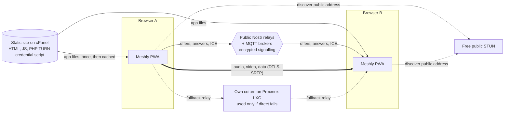

<p align="center">
  <strong>Meshly</strong><br>
  Private meetings, peer to peer. No servers, no sign-up.
</p>

---

Meshly is a free, installable web app (PWA) for voice, video, chat and screen-sharing meetings. Media travels directly between participants over WebRTC in a full mesh. There is no application backend: the app is a static site, call setup runs over public Nostr relays and MQTT brokers (end-to-end encrypted), and connectivity uses free public STUN first, falling back to a self-hosted TURN relay only when a direct path cannot be found.

Meshly is also a public demonstration of real-time communications architecture. It is designed and architected by **Faisal Hanif** ([GitHub](https://github.com/imfanee) · [LinkedIn](https://www.linkedin.com/in/faisal-hanif-ai-telecom/)).

> Status: **specification complete, development not started.** Implementation is carried out by an AI coding agent following [AGENTS.md](AGENTS.md) and the task list in [docs/11-ROADMAP-TASKS.md](docs/11-ROADMAP-TASKS.md). Progress is logged in [docs/PROGRESS.md](docs/PROGRESS.md).

## Features

| Area | What you get |
| --- | --- |
| Meetings | Start a meeting with just your name, share one link, guests knock and the host admits them |
| Media | Voice, video (up to 6 cameras), audio-only seats up to 12 people, screen sharing on desktop |
| Chat | Text chat, reactions, raise hand and file transfer over encrypted data channels |
| Recording | Host records the whole meeting (mixed audio and video) straight to their own disk |
| AI notes | Bring your own AI key (OpenAI, Anthropic, Google Gemini or any OpenAI-compatible endpoint) for live transcript, notes and summary; keys never leave your device |
| App | Installable PWA with a borderless window on desktop and a native-feeling app on phones; desktop and mobile layouts |
| Privacy | No accounts, no tracking, no stored data; signalling encrypted with a key that never leaves the link |

## How it works



1. The host enters a name. Meshly creates a room ID, a 128-bit room secret and a host signing key.
2. The share link looks like `https://meshly.example.com/r/<roomId>#<secret>.<hostKeyThumbprint>`. Everything after `#` stays in the browser and is never sent to any server.
3. A guest opens the link, previews camera and mic, and knocks. The host admits them with a signed ticket.
4. Peers negotiate WebRTC directly using free STUN. If a pair cannot connect within a few seconds, Meshly fetches short-lived TURN credentials and restarts ICE through the self-hosted relay.
5. After connecting, chat and control messages move to data channels. Nothing about the meeting is stored anywhere once everyone leaves.

Full details: [docs/02-ARCHITECTURE.md](docs/02-ARCHITECTURE.md).

## Browser support

| Feature | Chrome / Edge desktop | Safari macOS | Firefox desktop | Android Chrome | iOS Safari |
| --- | --- | --- | --- | --- | --- |
| Voice, video, chat | Yes | Yes | Yes | Yes | Yes |
| One-click install button | Yes | Add to Dock (guided) | No install | Yes | Add to Home Screen (guided) |
| Send screen share | Yes, with tab audio | Yes, no audio | Yes, no audio | No | No |
| Recording to a chosen folder | Yes | Download at end | Download at end | Download at end | Download at end |

## Repository layout

```
Meshly/
├── README.md                 This file
├── AGENTS.md                 Instructions for the AI development agent (start here if you are the agent)
├── CLAUDE.md                 Claude Code entry point (imports AGENTS.md)
├── agent/commands/           Agent task prompts (next-task, status, deploy-web, setup-turn); T0.1 copies them to .claude/commands
├── docs/                     Product spec, architecture, protocol, UI/UX, security, deployment, roadmap, ADRs
├── infra/
│   ├── cpanel/               .htaccess, TURN credential script (turn.php), config example
│   └── turn/                 coturn template and Proxmox provisioning scripts
├── app/                      Source code (Vite + Svelte 5 + TypeScript), created by the agent
└── web/                      Production build output. This folder is what gets uploaded to cPanel
```

## Documentation

| Document | Contents |
| --- | --- |
| [01 Product spec](docs/01-PRODUCT-SPEC.md) | Users, user stories, functional and non-functional requirements, limits |
| [02 Architecture](docs/02-ARCHITECTURE.md) | Components, module map, data flows, state model |
| [03 Signalling protocol](docs/03-SIGNALLING-PROTOCOL.md) | Link format, crypto, envelope, message types, admission tickets |
| [04 Media and ICE](docs/04-MEDIA-AND-ICE.md) | Mesh peer manager, perfect negotiation, staged STUN to TURN, bitrate policy |
| [05 UI/UX](docs/05-UI-UX.md) | Design system, screens, desktop and mobile layouts, PWA install UX |
| [06 Features](docs/06-FEATURES.md) | Chat, files, screen share, host controls, recording, AI notes |
| [07 Security and privacy](docs/07-SECURITY-PRIVACY.md) | Threat model, CSP, consent, legal pages |
| [08 Deployment (cPanel)](docs/08-DEPLOYMENT-CPANEL.md) | Subdomain, SSL, upload, TURN credential script, updates |
| [09 TURN on Proxmox](docs/09-TURN-PROXMOX.md) | LXC container, NAT, coturn hardening, certificates, operations |
| [10 Testing](docs/10-TESTING.md) | Unit, end-to-end, manual device matrix, release checklist |
| [11 Roadmap and tasks](docs/11-ROADMAP-TASKS.md) | Phased task list with acceptance criteria |
| [ADRs](docs/adr/) | Architecture decision records |

## Development

Development is agent-driven on Faisal's Windows machine. Requirements:

- Node.js LTS (22.x or newer) and npm
- Git, and OpenSSH client (built into Windows 10/11)
- Chromium-based browser for end-to-end tests (Playwright installs its own)

Typical commands once the app is scaffolded (run inside `app/`):

```bash
npm install
npm run dev          # local dev server (camera and mic work on localhost without HTTPS)
npm run test         # unit tests (Vitest)
npm run test:e2e     # end-to-end tests (Playwright, fake camera and mic, local dev relay)
npm run build        # production build into ../web
npm run deploy       # upload ../web to cPanel over SFTP (needs .secrets/sftp.json)
```

Secrets (SFTP credentials, Proxmox SSH key, TURN shared secret) live only in the git-ignored `.secrets/` folder. See [AGENTS.md](AGENTS.md#7-secrets).

## Deployment summary

1. Create a subdomain in cPanel (for example `meshly.example.com`) with AutoSSL enabled and PHP 8.1 or newer.
2. Upload the contents of `web/` to the subdomain's document root (manually or with `npm run deploy`).
3. Place `meshly-config.php` (TURN secret and host name) in the cPanel home folder, outside any document root.
4. Optionally provision the TURN relay on Proxmox ([docs/09](docs/09-TURN-PROXMOX.md)) and add a DNS `A` record `turn.example.com`.

Until the TURN relay exists, Meshly works with free STUN only; the small share of users behind strict NAT or corporate firewalls will see a clear "could not connect directly" message.

## Credits

Designed and architected by **Faisal Hanif**, senior VoIP and distributed-systems architect.

- GitHub: https://github.com/imfanee
- LinkedIn: https://www.linkedin.com/in/faisal-hanif-ai-telecom/

## Licence

To be decided before the first public release (see open questions in [docs/11-ROADMAP-TASKS.md](docs/11-ROADMAP-TASKS.md#open-questions)).
