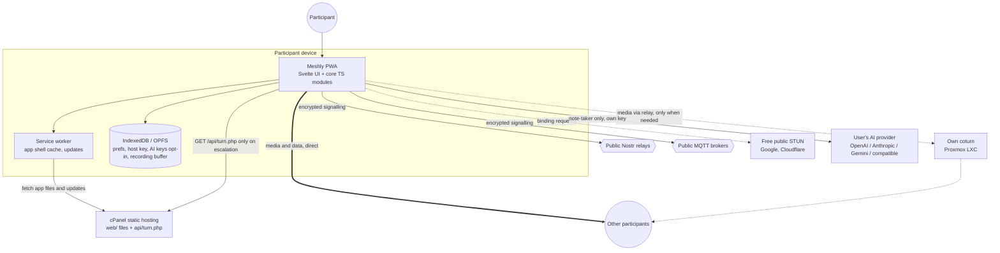
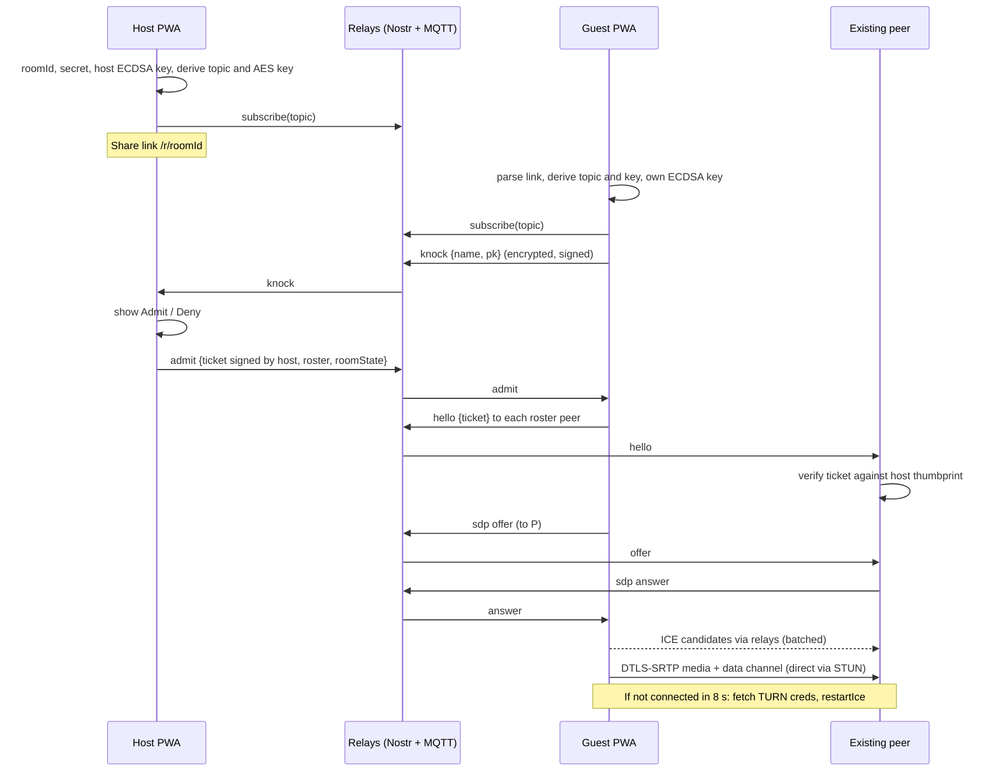

# 02 Architecture

Meshly is a static PWA with four runtime layers: the app shell (served once from cPanel, then cached), a multi-transport encrypted signalling layer over public relays, an ICE layer (free STUN first, own TURN on demand), and a full-mesh WebRTC media and data plane.

## 1. System context



## 2. Components

| Component | Responsibility | Lives in |
| --- | --- | --- |
| App shell | Routing, screens, design system, install UX, update prompts | `app/src/routes`, `app/src/lib/ui` |
| Room model | Room ID, secret, host key, link encode/decode, role | `core/room` |
| Crypto | HKDF key derivation, AES-GCM, ECDSA P-256 sign/verify, thumbprints, tickets | `core/crypto` |
| Signalling | Transport adapters (Nostr, MQTT, dev relay), fan-out, dedupe, replay protection, envelope codec | `core/signalling` |
| Admission | Knock, admit, deny, tickets, roster, capacity and video slots, host state | `core/admission` |
| Peer manager | One `RTCPeerConnection` per remote peer, perfect negotiation, staged ICE, restarts, stats | `core/peers` |
| Media | Local capture, device switching, constraints, bitrate policy, screen share, active speaker | `core/media` |
| Data | Control channel protocol, chat, reactions, file transfer | `core/data` |
| Recording | Compositor (canvas + Web Audio), MediaRecorder, disk/OPFS sinks | `core/recording` (lazy) |
| AI notes | Provider adapters, per-track segmenter, transcript store, summariser, consent | `core/ai` (lazy) |
| TURN credentials | Fetch and cache from `/api/turn.php` | `core/ice` |
| Storage | IndexedDB wrapper (prefs, host keys, AI keys) and OPFS helpers | `core/storage` |
| Service worker | Precache, runtime cache for fonts and icons, update flow | `vite-plugin-pwa` generated |
| TURN credential script | HMAC time-limited coturn credentials, rate limiting | `infra/cpanel/api/turn.php` |
| coturn relay | TURN/STUN over UDP, TCP, TLS 443 | Proxmox LXC, `infra/turn/` |

## 3. Module map

```
app/
├── index.html
├── vite.config.ts                 outDir ../web, PWA plugin, manifest
├── public/
│   ├── .htaccess                  copied from infra/cpanel/.htaccess
│   ├── assets/.htaccess           long cache for hashed assets
│   ├── api/turn.php               copied from infra/cpanel/api/turn.php
│   ├── fonts/                     Inter variable woff2
│   ├── icons/                     generated PWA icons
│   └── sounds/                    knock, join, leave, recording chimes (short, small)
├── src/
│   ├── main.ts
│   ├── App.svelte                 router outlet, theme, update toast
│   ├── config.ts                  reads Vite env, exports typed config
│   ├── routes/                    Home, PreJoin, Lobby, Call, PostCall, About, Privacy, Terms, NotFound
│   └── lib/
│       ├── ui/                    design system components (Button, IconButton, Dialog, Sheet, Toast, Tile, Panel...)
│       ├── stores/                Svelte runes stores: session, call, ui, settings
│       ├── i18n/en-GB.ts          all user-facing strings
│       ├── platform/              feature detection, install prompt, wake lock, in-app browser detection
│       └── core/                  framework-free TypeScript
│           ├── crypto/            hkdf.ts, aead.ts, sign.ts, encoding.ts, ticket.ts
│           ├── room/              room.ts, link.ts, hostKeyStore.ts
│           ├── signalling/        envelope.ts, transport.ts, nostr.ts, mqtt.ts, devRelay.ts, hub.ts
│           ├── admission/         lobby.ts, hostController.ts, roster.ts, slots.ts, roomState.ts
│           ├── peers/             peerManager.ts, peer.ts, negotiation.ts, iceStrategy.ts, stats.ts
│           ├── ice/               turnCredentials.ts, iceServers.ts
│           ├── media/             localMedia.ts, devices.ts, bitratePolicy.ts, screenShare.ts, activeSpeaker.ts
│           ├── data/              controlChannel.ts, chat.ts, reactions.ts, fileTransfer.ts
│           ├── recording/         compositor.ts, mixer.ts, recorder.ts, sinks.ts, ticker.worker.ts
│           ├── ai/                providers/*.ts, segmenter.ts, transcript.ts, summariser.ts, prompts.ts, consent.ts
│           └── storage/           db.ts, opfs.ts
├── tests/
│   ├── unit/                      Vitest
│   └── e2e/                       Playwright
└── tools/
    └── dev-relay.mjs              tiny local WebSocket relay for dev and e2e only (never deployed)
```

## 4. Key flows

### 4.1 Create and join



### 4.2 Staged ICE

See [04-MEDIA-AND-ICE.md](04-MEDIA-AND-ICE.md#4-staged-ice-stun-first-turn-on-demand).

### 4.3 Leave and end

- Leave: send `bye` over signalling and data channels, close PCs, stop tracks, go to Post-call.
- Host ends: host signs `end`; every peer verifies, shows "The host ended the meeting", leaves. Host key deleted from IndexedDB.
- Tab closed without `bye`: peers detect via data channel close or ICE `failed` after restarts, and remove the tile after 15 s.

## 5. State model

Client state is held in Svelte rune stores derived from core module events. Core modules expose an event emitter API; stores subscribe.

| Store | Key fields |
| --- | --- |
| `session` | `displayName`, `peerId`, `role`, `roomId`, `link`, `phase` (`home`, `prejoin`, `lobby`, `call`, `ended`) |
| `call` | `peers: Map<peerId, PeerView>` (name, tracks, mute, video, hand, connection type, quality), `roomState` (locked, video slots, recording, note-takers), `screenShare`, `activeSpeaker`, `chat[]`, `knocks[]` |
| `ui` | layout mode, open panel, toasts, dialogs, install state, update available |
| `settings` | devices, theme, AI providers (keys only in memory unless remembered), relay-only mode, transport toggles |

Authoritative room state (roster, locked, video slots, recording, note-takers) is owned by the host, versioned with a sequence number, signed, and broadcast on change over data channels (and signalling for peers not yet connected). Peers apply only states with a higher `seq` and a valid host signature.

## 6. Failure handling summary

| Failure | Behaviour |
| --- | --- |
| No relay reachable | Retry with backoff; after 10 s show "Cannot reach the meeting network. Check your connection." |
| One transport down | Other transport carries traffic transparently (fan-out) |
| Pair fails with STUN | Escalate to TURN (staged ICE) |
| TURN endpoint unavailable (404/503) | Show "Could not connect to <name> directly, and the relay is unavailable" on that tile; keep retrying ICE every 30 s |
| Host absent | Guests wait in lobby with "The host is away" |
| Camera/mic denied | Join audio-only or listen-only with clear instructions to re-enable in browser settings |
| Browser unsupported (no `RTCPeerConnection`) | Unsupported screen with links to supported browsers |
| In-app browser (WhatsApp, Instagram, LinkedIn, Facebook) | Banner "Open in your browser for camera and install support" with copy-link button |

## 7. Deployment view

| Artefact | Where | Notes |
| --- | --- | --- |
| `web/` (static build) | cPanel subdomain document root | Uploaded by `npm run deploy` or manually |
| `web/api/turn.php` | Same document root | Reads config from home folder |
| `meshly-config.php` | cPanel home folder (outside any docroot) | TURN secret, host, TTL, rate limit |
| coturn | Proxmox unprivileged LXC behind host NAT | Ports 3478 UDP/TCP, 443 TCP (TLS), 49160 to 49660 UDP |
