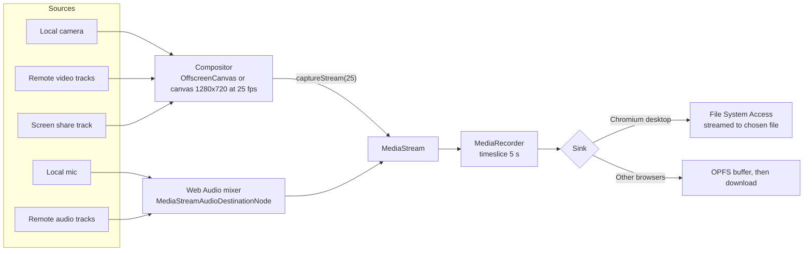

# 06 Feature specifications

Detailed behaviour for chat, files, screen sharing, host controls, local recording and bring-your-own-key AI notes. Protocol messages referenced here are defined in [03-SIGNALLING-PROTOCOL.md](03-SIGNALLING-PROTOCOL.md#8-data-channel-control-protocol).

## 1. Chat, reactions, raise hand

- Each message is sent individually to every connected peer's `ctl` channel (mesh fan-out) with a shared message `id`; receivers dedupe.
- Private message: `to: peerId` sends only to that peer; UI shows "Private" label.
- Max 2,000 characters; rendered as plain text with link detection (no HTML, no Markdown).
- History exists only in memory for the meeting; late joiners do not receive earlier messages (stated in the empty chat: "Messages are only shared with people in the meeting right now.").
- "Export chat" in the chat menu downloads a `.txt` file.
- Reactions: fixed set of 8 (thumbs up, clap, laugh, heart, surprised, thinking, party, raised hands). Float up over the sender's tile for 3 s; rate-limited to 1 per second per sender.
- Raise hand: badge on tile and in People list, ordered by time raised; host can lower anyone's hand.

## 2. File transfer

- Sender picks a file (max 100 MB). `file-offer` goes to everyone (or one peer). Receivers see a card: name, size, Accept, Decline.
- On accept, the sender opens a `file:<fileId>` data channel to that receiver and streams 16 KB chunks with backpressure (`bufferedAmountLowThreshold = 1 MB`), sending a final SHA-256 for verification.
- Receiver assembles in memory up to 25 MB, otherwise streams to OPFS; "Save" triggers a download with the original name (sanitised).
- Progress, cancel and failure states on both sides. Never auto-open received files.
- Lazy-load the module on first use.

## 3. Screen sharing

- Button visible only when `navigator.mediaDevices.getDisplayMedia` exists and pointer is fine (desktop).
- One sharer at a time. A participant sends `share-req` to the host; host auto-approves if nobody is sharing (state `screenSharer` updated); if someone is, the requester sees "Sam is sharing. Ask them to stop first."
- Sharer adds a new `video` transceiver (sendonly) per peer, sets `contentHint = "detail"`, bitrate per doc 04, sends `tracks` message with the screen `mid`.
- Tab or system audio (Chromium only) is added as a second audio track and mixed at receivers.
- Stop: user clicks Stop, or browser "Stop sharing" bar fires `track.onended`; remove transceiver tracks (`replaceTrack(null)`, then stop), update state.
- Sharer sees a small self-preview with a warning outline and "You are sharing your screen" pill (avoid infinite mirror by not showing full self-share).

## 4. Host controls

| Control | Mechanism |
| --- | --- |
| Admit / Deny | `admit` / `deny` over signalling (doc 03) |
| Admit all | Loop over queued knocks within capacity |
| Lock | State `locked: true`; new knocks receive `deny {reason: "locked"}` |
| Remove | State `kicked += peerId` and `kick` message; everyone closes the PC; kicked peer cannot re-admit with the same key; host may admit them again only if they knock with a new session |
| Ask to mute | `mute-req`; target sees a toast with "Mute" button. Never remote-muted without consent |
| Lower hand | `media` override message |
| Grant camera slot | Automatic first come, first served while slots free; host can reassign from People list |
| End for everyone | `end` signed; host key deleted |
| Transfer host | Not in v1 (open question) |

## 5. Local recording (host only)

### Goal

One file containing the meeting as everyone saw it: a mixed video (grid of cameras or screen share layout) and all audio, saved to the host's own device. Optionally audio only.

### Pipeline



### Details

- **Format selection:** first supported of `video/webm;codecs=vp9,opus`, `video/webm;codecs=vp8,opus`, `video/mp4;codecs=avc1,mp4a.40.2`, `video/mp4`. Audio-only: `audio/webm;codecs=opus`, `audio/mp4`. Target video bitrate 2.5 Mbps, audio 128 kbps.
- **Compositor layout:** mirrors the grid rules from doc 05 (up to 6 video tiles; avatar tiles with initials for audio-only participants; name labels; speaking ring). When a screen is shared: screen at 75% width, camera tiles stacked on the right.
- **Background-safe clock:** hidden tabs throttle `requestAnimationFrame` and timers. Drive frames from a dedicated Worker (`ticker.worker.ts`) posting a message every 40 ms; draw on each message. A call tab plays audio and is normally exempt from heavy throttling; still, test with the tab hidden for 5 minutes (acceptance criterion).
- **Sinks:**
  - Chromium desktop: `showSaveFilePicker({ suggestedName: "meshly-YYYY-MM-DD-HHmm.webm" })` before starting; write each 5 s chunk with a `FileSystemWritableFileStream`; close on stop. Memory stays flat for long recordings.
  - Other browsers: append chunks to an OPFS file; on stop, build a `File` from OPFS and trigger download; then delete the OPFS file. If OPFS is unavailable, keep chunks in memory and warn when over 1 GB.
- **WebM duration:** MediaRecorder WebM files lack duration metadata (seeking may not work in some players). For in-memory/OPFS recordings under 2 GB, patch duration with `fix-webm-duration` before download. For streamed files, document the limitation and offer "Fix seeking" which rewrites the header in place (phase 6, optional).
- **Consent and signalling:** before starting, host sees a dialog "Everyone will be told this meeting is being recorded." Starting sets `recording: true` in room state; every client shows a persistent red "Recording" pill and plays a chime; stopping does the same.
- **Failure:** if the host leaves or closes the tab, finalise what exists (Chromium file is already on disk up to the last chunk). On crash, OPFS leftovers are offered on next launch: "A recording from your last meeting was not saved. Save it now?"
- Lazy-load the recording module when the host opens the Record control.

## 6. AI notes (bring your own key)

### Principles

- No Meshly server is involved. Calls go from the note-taker's browser straight to the provider they chose, with their key.
- Only the note-taker's device processes audio. In a mesh, the note-taker already receives each participant's audio as a separate track, so speaker attribution is free and other participants need no key.
- Explicit opt-in consent per participant. No consent, no transcription of that person.
- Keys stored in IndexedDB only if "Remember on this device" is ticked; otherwise memory only. Never sent to peers, signalling or our hosting.

### Providers

Implement one adapter interface:

```ts
interface AiProvider {
  id: "openai" | "anthropic" | "gemini" | "openai-compatible" | "local-whisper";
  label: string;
  capabilities: { transcribe: boolean; summarise: boolean };
  transcribe?(audio: Blob, opts: { language?: string; prompt?: string }): Promise<string>;
  complete?(system: string, user: string, opts: { maxTokens: number }): Promise<string>;
  test(): Promise<void>; // cheap call to validate the key
}
```

| Provider | Transcription | Summary | Browser notes |
| --- | --- | --- | --- |
| OpenAI | `POST https://api.openai.com/v1/audio/transcriptions` (multipart) | `POST /v1/chat/completions` | Supports CORS with user key |
| Anthropic | No | `POST https://api.anthropic.com/v1/messages` with headers `x-api-key`, `anthropic-version: 2023-06-01`, `anthropic-dangerous-direct-browser-access: true` | Pair with another provider for transcription |
| Google Gemini | Yes (audio part in `generateContent`) | `generateContent` | Key as `x-goog-api-key` header |
| OpenAI-compatible | `{baseUrl}/audio/transcriptions` if supported (for example Groq) | `{baseUrl}/chat/completions` (OpenRouter, Groq, Ollama, LM Studio) | Local endpoints must allow our origin (for example Ollama `OLLAMA_ORIGINS`) |
| Local Whisper (phase 6) | `@huggingface/transformers` Whisper on WebGPU/WASM, fully on device | No | Model download about 40 to 150 MB, cached |

- Settings has separate "Transcription" and "Summaries" provider pickers, each with model field (editable), key field, and Test button.
- **Model IDs change.** Ship defaults verified against provider docs at build time (record in `docs/spikes/ai-models.md`) and keep them editable. Anthropic default summary model: `claude-haiku-5-5` (cheap, fast); users may switch to `claude-sonnet-5-5`.
- Show a cost note: "Transcription and summaries are billed to your own AI account."

### Consent flow

1. Note-taker clicks "Start AI notes" (Notes tab). If providers are not configured, open Settings, AI.
2. Note-taker's client sends `notes-consent-req` to every peer and asks the host's client to add it to `noteTakers` in room state (granted automatically), so everyone sees the AI notes pill.
3. Each participant sees a dialog: "Faisal wants to use AI notes. Allow their AI provider to transcribe your voice? You can change this any time." Buttons: Allow, Decline. No answer in 30 s counts as Decline.
4. Participants can revoke from the AI notes pill at any time (`notes-consent {allow: false}`); the note-taker stops processing that track immediately.
5. The note-taker's own mic is included by default.

### Transcription pipeline

- Per included audio track: a `MediaRecorder` producing standalone segments of about 20 s (stop and restart the recorder each segment so every blob is a valid file).
- Silence skip: an `AnalyserNode` tracks RMS; a segment with speech below threshold for over 95% of its duration is discarded (saves cost).
- Upload queue with concurrency 2, retry with backoff on 429/5xx, drop after 3 failures with a visible warning.
- Each result becomes transcript lines `{ speaker: name, ts: segmentStart, text }`, appended in time order.
- Language: auto, with optional override in Settings.

### Notes and summary

- **Live notes:** every 5 minutes (and on demand with "Update notes") send the transcript since the last update plus previous notes to the summary model; display bullet notes.
- **Final summary:** on "End AI notes" or meeting end, produce Markdown with sections: Summary, Decisions, Action items (owner, task, due if mentioned), Open questions, Key moments.
- Prompts live in `core/ai/prompts.ts`, instruct the model to use only the transcript, use participants' names, British English, and no em-dashes.
- Export: "Download notes (.md)" containing title, date, participants, summary, then full transcript. "Share with everyone" sends the Markdown over data channels as a `transcript`/notes message; recipients can download it.
- Clear transcript from memory when the note-taker leaves, unless downloaded.

### Limits

- Note-taker CPU and upload: 11 recorders at 20 s segments is fine on laptops; on phones, cap note-taking to 6 tracks and warn.
- Long meetings: summarise in rolling windows to keep prompts under about 30,000 tokens.
