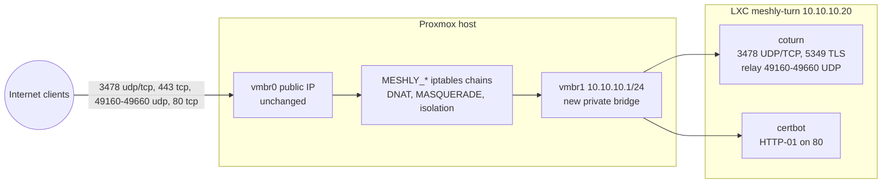

# 09 TURN relay on Proxmox

Meshly's own TURN relay is coturn in an unprivileged LXC container on Faisal's Proxmox host (public IPv4, 500 Mbit/s). It is used only when free STUN cannot connect a pair. The container sits on a private bridge behind host NAT, so the hypervisor exposes only the TURN ports and the container cannot reach the host.

## 1. Why an LXC container (not the host, not a VM)

| Option | Verdict |
| --- | --- |
| coturn directly on the Proxmox host | Rejected: exposes a large UDP range on the hypervisor; a coturn bug or misconfiguration could reach the Proxmox UI (8006), SSH and other guests |
| Full VM | Not possible: not enough free storage |
| Unprivileged LXC | Chosen: about 1 GB disk used (4 GB allocated), 512 MB RAM, shares the kernel, isolated by namespaces, own firewall boundary |

## 2. Target layout



Ports exposed on the public IP (all forwarded to the container, nothing new listens on the host itself):

| Public port | Container port | Purpose |
| --- | --- | --- |
| UDP 3478 | 3478 | STUN and TURN over UDP (best quality) |
| TCP 3478 | 3478 | TURN over TCP |
| TCP 443 | 5349 | TURN over TLS (passes corporate firewalls); Proxmox UI stays on 8006 |
| UDP 49160 to 49660 | same | Relay allocations (about 250 concurrent relayed streams) |
| TCP 80 | 80 | Let's Encrypt HTTP-01 only during issue and renewal |

## 3. Capacity and limits

- A relayed 720p stream is about 1.2 Mbit/s each way; coturn counts both directions.
- `bps-capacity=31250000` bytes/s caps coturn at 250 Mbit/s (half the link), leaving headroom for the host's other workloads.
- `max-bps=375000` bytes/s (3 Mbit/s) per session allows camera plus screen share.
- `user-quota=6`, `total-quota=400` allocations.
- With staged ICE, expect only 10 to 20% of pairs to need the relay.

## 4. Prerequisites (Faisal)

1. `.secrets/proxmox.json` and `.secrets/proxmox_key` (root SSH key for the host). Fix the key ACL (AGENTS.md section 7).
2. DNS `A` record `turn.<domain>` to the Proxmox public IP (cPanel Zone Editor), TTL 300.
3. ACME email for Let's Encrypt.
4. Approval for each write stage below.

## 5. Procedure

All commands run from the repo root on the Windows machine. Replace `$P` with the values from `.secrets/proxmox.json`: for example `ssh -i .secrets/proxmox_key -p 22 -o StrictHostKeyChecking=accept-new root@<host>`. Use `scp` to copy files (works in PowerShell and Git Bash; avoids CRLF problems with stdin piping).

### Stage A: discovery (read-only, no approval needed)

```bash
ssh $P "mkdir -p /root/meshly && chmod 700 /root/meshly"
scp -i .secrets/proxmox_key -P <port> infra/turn/discover.sh root@<host>:/root/meshly/
ssh $P "bash /root/meshly/discover.sh" > .secrets/proxmox-discovery.txt
```

Summarise for Faisal: Proxmox version, free guest ID, storages and free space, bridges and subnets in use, anything listening on 80/443/3478/5349, firewall type and state (pve-firewall iptables, or proxmox-firewall nftables), latest Debian template name. Propose values for `.secrets/host.env` (from `infra/turn/host.env.example`). Choose a subnet not in use (default `10.10.10.0/24`).

If `proxmox-firewall` (nftables) is active, stop and discuss with Faisal: the iptables-based NAT script may need an nftables variant.

### Stage B: host network (gated)

```bash
scp -i .secrets/proxmox_key -P <port> .secrets/host.env infra/turn/host-setup.sh infra/turn/meshly-turn-nat.sh infra/turn/meshly-turn-nat.service root@<host>:/root/meshly/
ssh $P "chmod 600 /root/meshly/host.env && bash /root/meshly/host-setup.sh preflight"
# show output to Faisal, get "go"
ssh $P "bash /root/meshly/host-setup.sh network"
# open a SECOND, fresh connection to prove access survives:
ssh $P "echo still reachable && ip -br addr show vmbr1"
ssh $P "bash /root/meshly/host-setup.sh disarm"
```

If the fresh connection fails, do nothing: the host restores `/etc/network/interfaces` automatically after 5 minutes. Report to Faisal.

### Stage C: NAT and isolation (gated)

```bash
ssh $P "bash /root/meshly/host-setup.sh nat"
```

Creates chains `MESHLY_PRE`, `MESHLY_POST` (nat) and `MESHLY_FWD`, `MESHLY_IN` (filter), enabled at boot by `meshly-turn-nat.service`. Rules:

- DNAT public ports to the container (table in section 2).
- Hairpin NAT for the relay range so two peers both relayed via this server can reach each other.
- MASQUERADE container egress.
- Drop everything from the container subnet to the host itself.

### Stage D: container and coturn (gated)

```bash
ssh $P "bash /root/meshly/host-setup.sh container"
scp -i .secrets/proxmox_key -P <port> infra/turn/container-setup.sh infra/turn/turnserver.conf.template .secrets/turn.env root@<host>:/root/meshly/
ssh $P "CT=<CTID>; pct push \$CT /root/meshly/container-setup.sh /root/container-setup.sh && pct push \$CT /root/meshly/turnserver.conf.template /root/turnserver.conf.template && pct push \$CT /root/meshly/turn.env /root/turn.env --perms 600 && shred -u /root/meshly/turn.env && pct exec \$CT -- bash /root/container-setup.sh"
```

The script installs coturn, certbot, unattended-upgrades and vnstat; verifies DNS; renders `/etc/turnserver.conf`; obtains the certificate; installs a deploy hook that copies certificates to `/etc/coturn/certs` (readable by the `turnserver` user) and restarts coturn on renewal; starts coturn; runs a renewal dry run; shreds `/root/turn.env`.

### Stage E: verification

1. **Ports from outside** (PowerShell): `Test-NetConnection turn.<domain> -Port 443` and `-Port 3478` both `TcpTestSucceeded : True`.
2. **Certificate** (Git Bash): `openssl s_client -connect turn.<domain>:443 -servername turn.<domain> </dev/null 2>/dev/null | openssl x509 -noout -subject -dates` shows the Let's Encrypt certificate.
3. **Relay candidate:** generate a test credential locally:
   ```bash
   node -e "const c=require('crypto');const s=process.argv[1];const u=(Math.floor(Date.now()/1000)+3600)+':test';console.log(u);console.log(c.createHmac('sha1',s).update(u).digest('base64'))" <TURN_SECRET>
   ```
   Open the WebRTC samples Trickle ICE page (`https://webrtc.github.io/samples/src/content/peerconnection/trickle-ice/`), add `turn:turn.<domain>:3478?transport=udp` with that username and credential, gather: a `relay` candidate with the public IP must appear. Repeat with `turns:turn.<domain>:443?transport=tcp`.
4. **Isolation:** from the container, `pct exec <CTID> -- curl -m 3 -sk https://<BRIDGE_IP>:8006` must time out (host protected).
5. **Logs:** `pct exec <CTID> -- journalctl -u coturn -n 30 --no-pager` shows no errors.

### Stage F: wire into Meshly (gated deploy)

1. Render `.secrets/meshly-config.php` (secret from `turn.env`, `turn_host`, `allowed_hosts`).
2. `npm run deploy -- --config-only` uploads it to the cPanel home folder (mode 600).
3. Set `VITE_OWN_STUN_URL=stun:turn.<domain>:3478` in `app/.env.production`, rebuild and deploy.
4. End-to-end test: force relay with Settings, Advanced, "Hide my IP address", join from two devices, and confirm both tiles show "Relayed".
5. Record in PROGRESS.md (no IPs).

## 6. Operations

| Task | How |
| --- | --- |
| Snapshot/backup | `vzdump <CTID> --mode snapshot --compress zstd` after setup and after changes (tiny) |
| Bandwidth | `pct exec <CTID> -- vnstat -m` monthly; `vnstat -l` live |
| Sessions | `journalctl -u coturn` (allocations logged in simple-log format) |
| Rotate secret | Generate new `TURN_SECRET`, update `/etc/turnserver.conf` (re-run container-setup with new env) and `meshly-config.php` together; all old credentials die at once |
| Certificate | Renews automatically via the Debian certbot timer; deploy hook restarts coturn |
| Updates | Unattended security upgrades inside the container; review coturn release notes quarterly |
| Disable relay quickly | Remove `meshly-config.php` from cPanel (clients fall back to STUN only) or `pct stop <CTID>` |
| Uninstall | `host-setup.sh uninstall`, `pct destroy <CTID>` (gated), remove the bridge stanza |

## 7. Known limitations

- IPv4 only. IPv6 relay can be added later (needs a routed IPv6 prefix on the host).
- If the Proxmox host's existing firewall policy drops forwarded traffic before the `MESHLY_FWD` jump (rare, since the jump is inserted first), adjust after discovery.
- If port 80 is unavailable, switch certbot to DNS-01 (cPanel DNS API) or use a self-managed certificate; discuss with Faisal.
